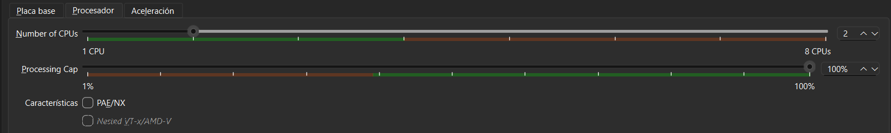
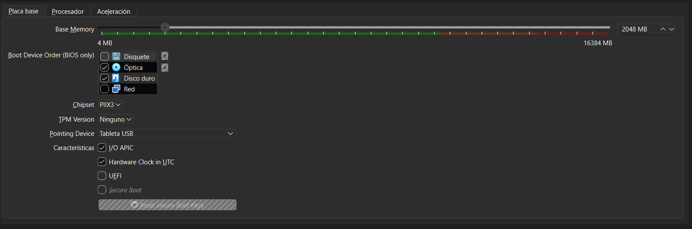
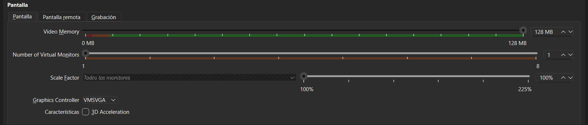
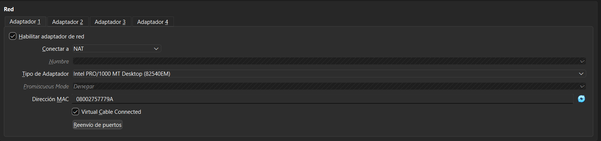
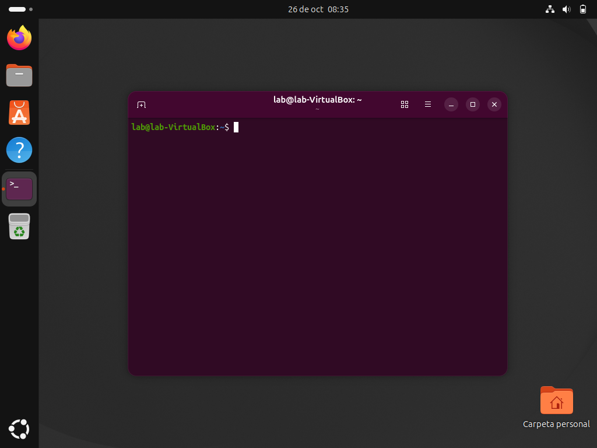
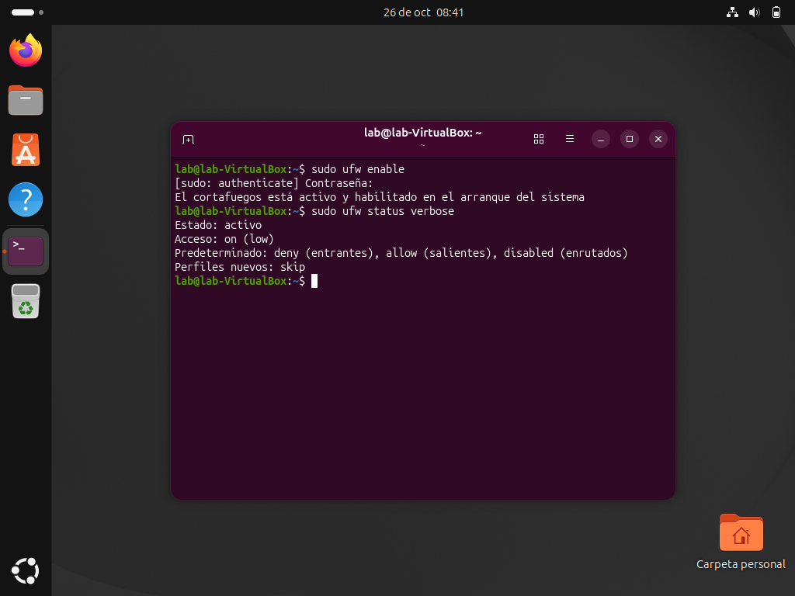
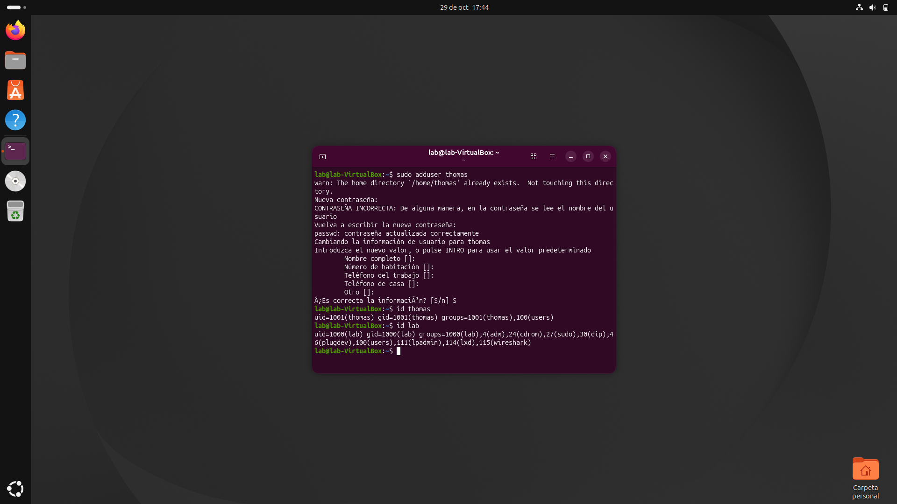
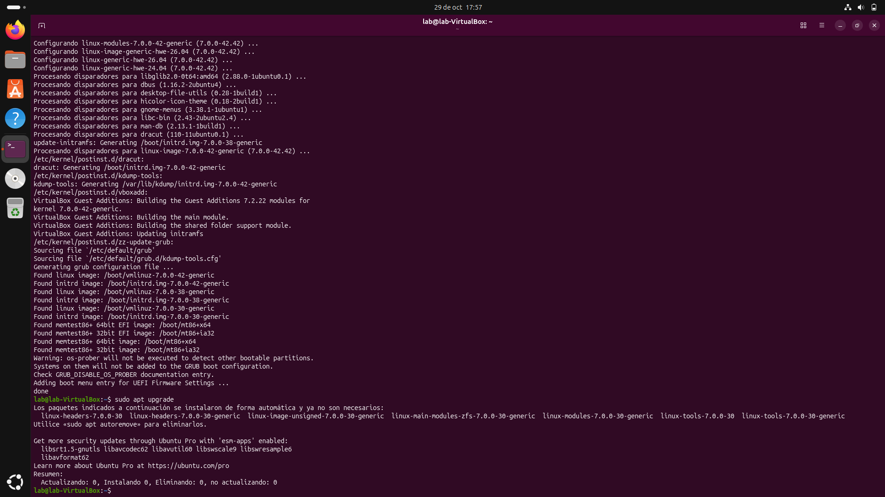
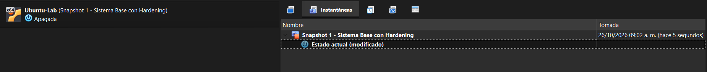

## 📸 Evidencias del Proceso

### 1. Configuración de Hardware
Asignación de recursos moderados (2 vCPUs, memoria RAM optimizada y memoria de video dedicada con aceleración gráfica).

  

  

  

---

### 2. Aislamiento de Red (Modo NAT)
Configuración previa al primer encendido estableciendo el adaptador en modo NAT para garantizar el aislamiento de la red física local.

  

---

### 3. Despliegue del Sistema Operativo
Inicio y validación de la sesión en Ubuntu Desktop con el usuario de trabajo configurado.

  

---

### 4. Hardening Básico
Aplicación de medidas básicas de aseguramiento: actualización de repositorios y paquetes, auditoría de puertos/servicios y activación del firewall UFW.

  

---

### 5. Usuario sin privilegios

Creación de un usuario estándar (sin permisos de administrador) y listado de los usuarios del sistema.

  

---

### 6. Actualización del sistema

Ejecución de `apt update` y `apt upgrade` sin errores, con confirmación de que no quedan paquetes pendientes.

  

---

### 7. Snapshot "Hardening Inicial"

Creación del punto de restauración en VirtualBox para preservar el estado limpio y seguro de la máquina, con el usuario estándar creado y el sistema actualizado.

  

